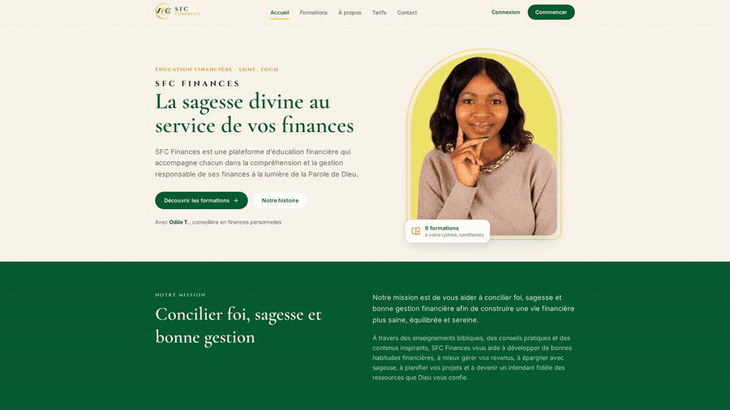
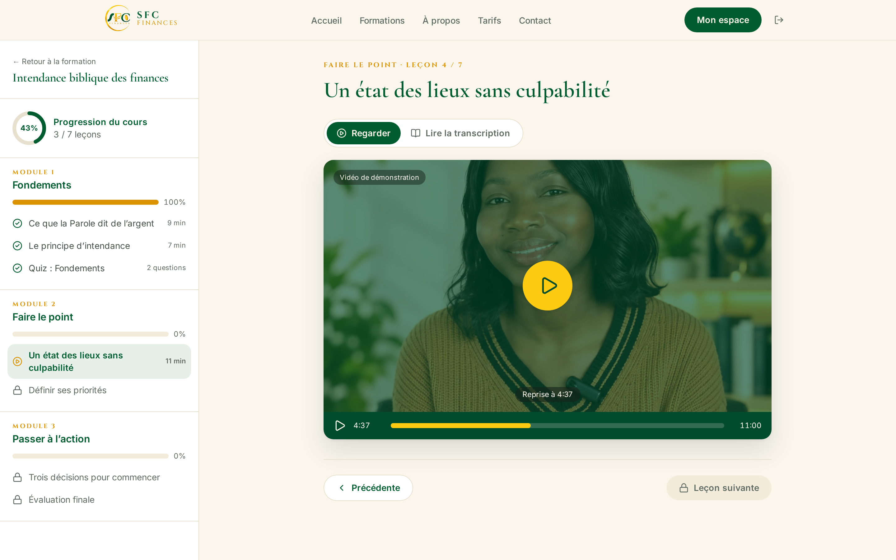
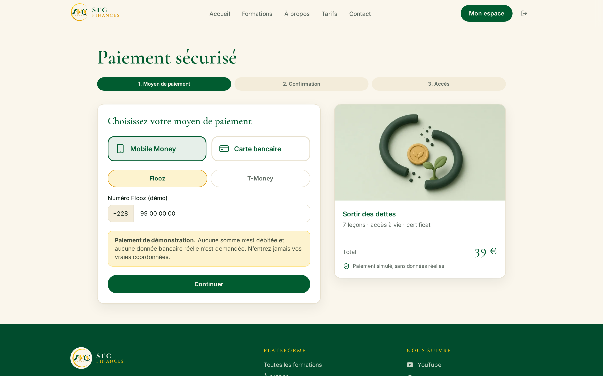
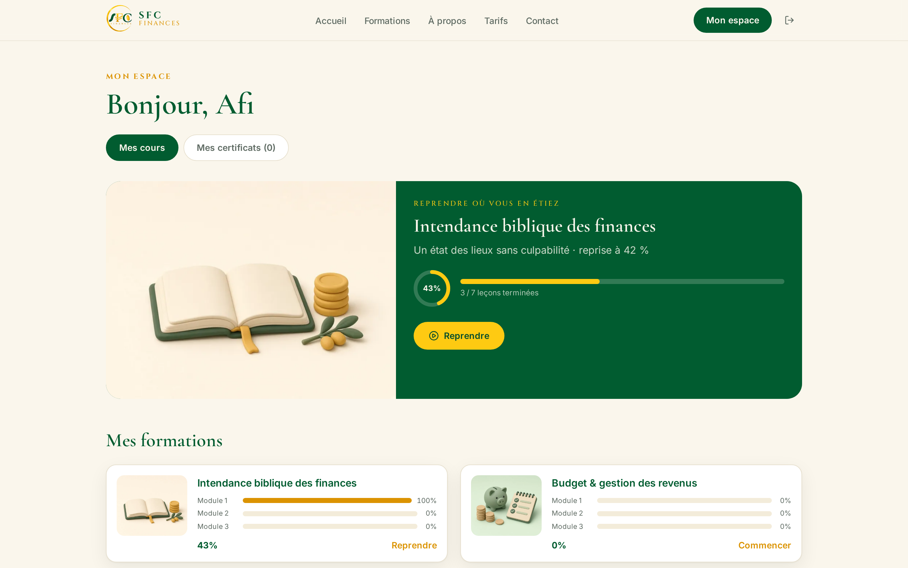
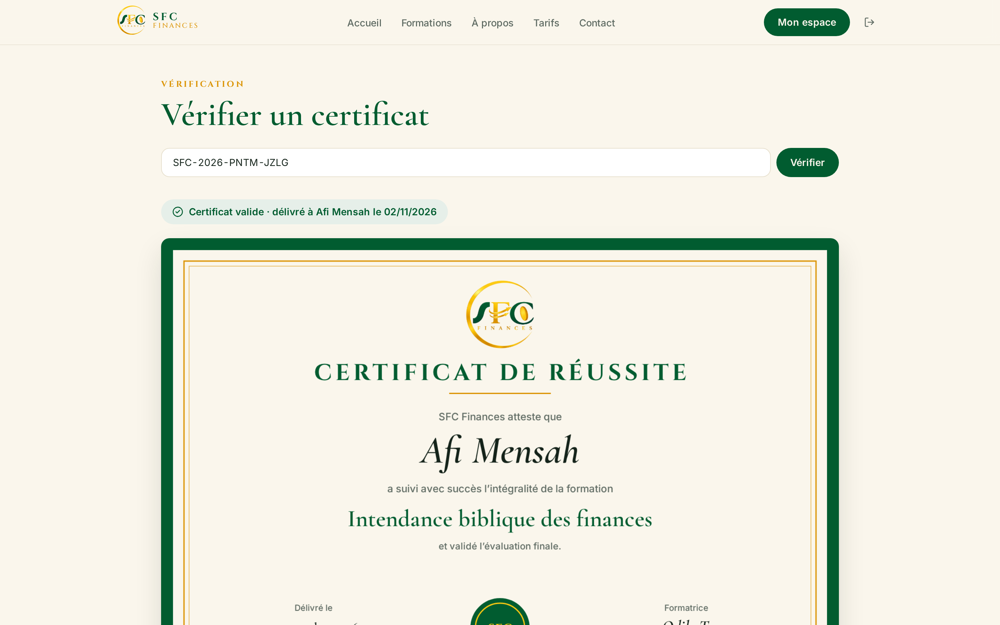
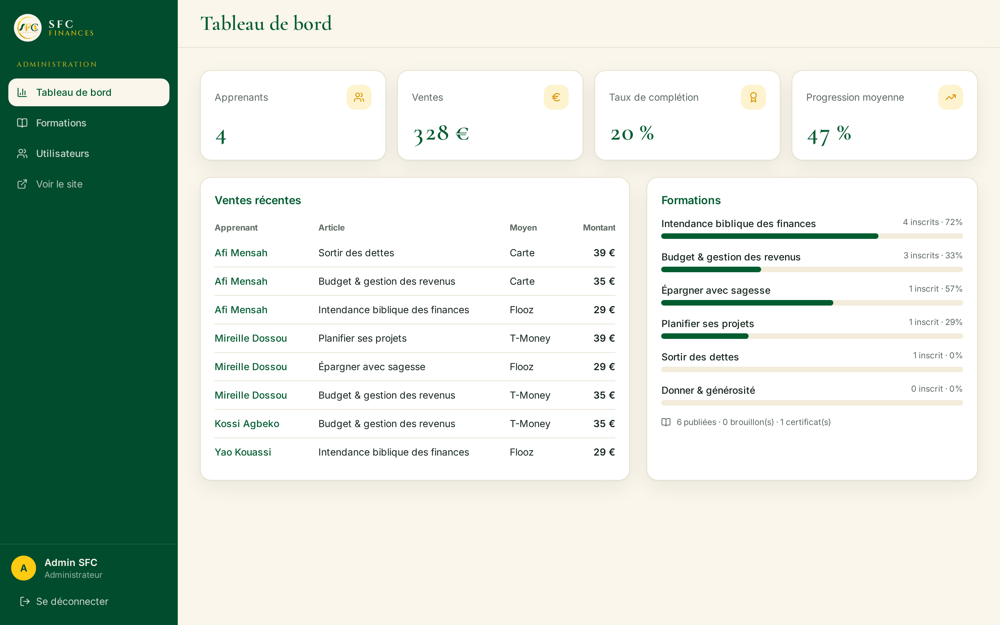
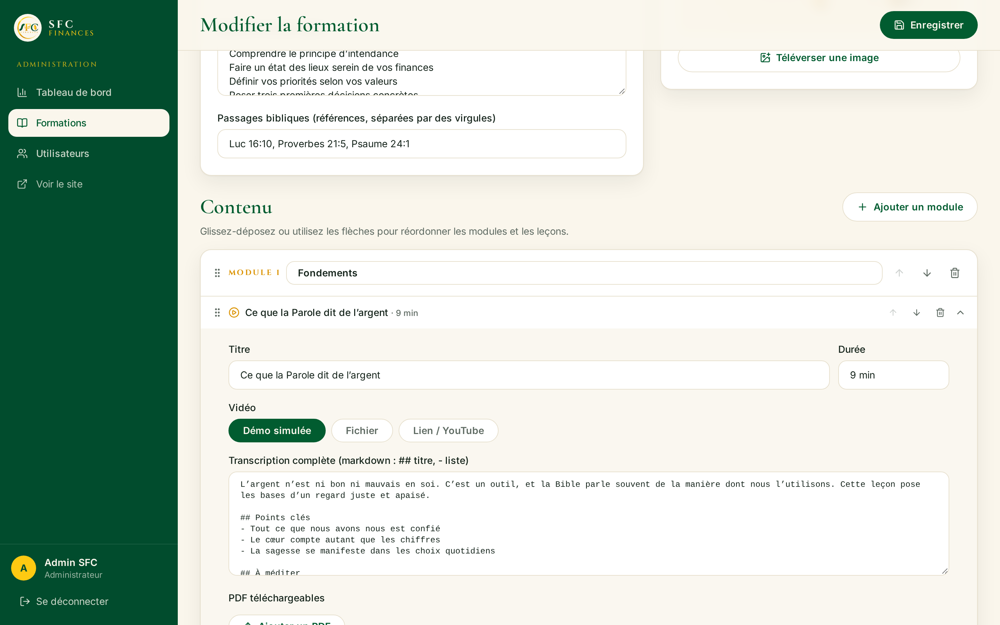
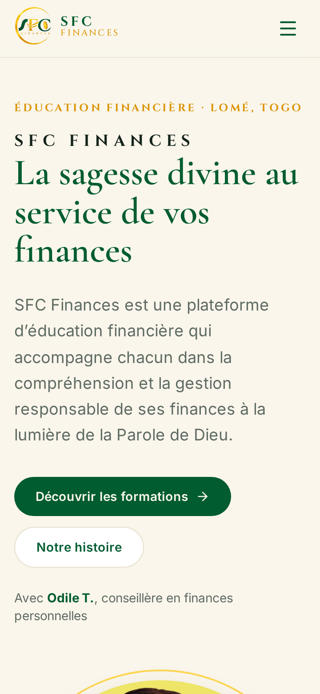
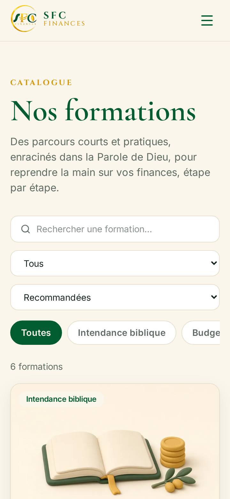

<div align="center">


# SFC Finances Academy

**La sagesse divine au service de vos finances**

An e-learning platform with a showcase site, a Coursera-style learning space, simulated checkout, certificates and an admin studio. Built for **SFC Finances**, Christian financial education from Lomé, Togo.

[**🌐 Live demo**](__LIVE__) · [Portfolio](https://donchaminade-alpha.vercel.app) · [Brand charter](docs/brand.md) · [Demo accounts](DEMO_ACCOUNTS.md)

⭐ **If this project helps or inspires you, please Star & Fork it!** ⭐



</div>

---

## ✨ Features

**Showcase site**
- Landing page with the brand promise, the founders' story (Directrice and Odile T.), values, plans in €, an FAQ, and contact links to YouTube, Facebook, Instagram and the WhatsApp channel.
- Catalogue with filters, plus course pages showing the syllabus, learning outcomes, instructor and price (also converted to FCFA).

**Learning space (LMS)**
- Sign-up and log-in (simulated; passwords are hashed with SHA-256 and kept in local storage).
- **Simulated payment** with Mobile Money (Flooz / T-Money) or card, in 3 steps: method → confirmation → access.
- **Sequential locking**: a lesson unlocks only when the previous one is finished (video watched, reading scrolled to the end, quiz passed).
- **Resume where you left off**, at both lesson and video-timestamp level, plus progress per course and per module (ring and bars).
- Lessons can be a video (demo, uploaded file or YouTube/URL) with a full transcript, a reading, downloadable PDFs or a quiz. Quizzes pass at ≥ 70 % and the final assessment at ≥ 80 %.
- **Certificate** generated in PNG and PDF (jsPDF), with a public verification page at `/certificats/:id`.

**Admin studio (`/admin`)**
- Dashboard KPIs: learners, sales, completion and average progress.
- CRUD for formations, and a **content builder** where modules and lessons can be reordered by drag-and-drop or arrows. Video and PDF uploads are stored in IndexedDB; the builder also has a transcript editor and a quiz editor.
- A users list, with each learner's progress detail.

**Quality**
- Installable **PWA** with offline shell and cached fonts.
- **SEO**: every public route is pre-rendered to static HTML, with per-page meta, Open Graph, JSON-LD (EducationalOrganization, Course, Person, FAQ), a sitemap and robots.txt.
- Smooth motion: reveals, stagger, parallax and page fades. It respects `prefers-reduced-motion`.
- Responsive from 360 px upward.

> ℹ️ This is a functional **front-end mockup**. No backend, no real payments. Data lives in your browser.

## 📸 Screenshots

| Landing | Course |
| --- | --- |
|  |  |
| **Player with resume** | **Simulated checkout** |
|  |  |
| **Dashboard** | **Certificate** |
|  |  |
| **Admin dashboard** | **Content builder** |
|  |  |

<p align="center"> </p>

## 🎨 Brand charter

| | Colour | Hex |
| --- | --- | --- |
|  | SFC Green | `#015C30` |
|  | Deep Green | `#014C2D` |
|  | SFC Gold | `#FECA12` |
|  | Deep Gold | `#DB9301` |
|  | Cream | `#FAF6EC` |

Fonts: **Cinzel** for the wordmark and labels, **Cormorant Garamond** for headings, **Inter** for UI text. All colours are solid; there are no gradients. Full details: [docs/brand.md](docs/brand.md).

## 🚀 Getting started

```bash
git clone https://github.com/Donchaminade/sfc-finances-academy.git
cd sfc-finances-academy
npm install
npm run dev      # http://localhost:5173
npm run build    # type-check + sitemap + build + SSR prerender → dist/
```

Demo logins are listed in [DEMO_ACCOUNTS.md](DEMO_ACCOUNTS.md). The login page also has one-click fill buttons.

## 🧱 Tech stack

React 19 · TypeScript · Vite 8 · Tailwind CSS 4 · motion · lucide-react · jsPDF · vite-plugin-pwa · IndexedDB · static SSR prerendering · Vercel

```
src/
  content/    brand copy, about page, socials
  data/       types, seed formations, demo accounts
  lib/        store (localStorage), IndexedDB files, router, SEO, markdown
  components/ UI kit, motion, progress ring, certificate
  pages/      public pages, learning space, admin studio
scripts/      sitemap + prerender
```

## 🙏 Credits & inspiration

UI and motion inspiration from **[@code.xr](https://www.instagram.com/code.xr/)** reels: [DZPqMZ2T1PA](https://www.instagram.com/reel/DZPqMZ2T1PA/), [DeoxA_vzRbo](https://www.instagram.com/reel/DeoxA_vzRbo/), [DcGgytAzym7](https://www.instagram.com/reel/DcGgytAzym7/).

Brand, copy and photos © SFC Finances.

---

## 🇫🇷 Résumé en français

**SFC Finances Academy** est la plateforme de formation en ligne de SFC Finances (Lomé, Togo). Elle propose :

- un site vitrine ;
- un espace apprenant façon Coursera : achat simulé par Mobile Money ou carte, leçons débloquées l'une après l'autre, reprise automatique, progression par cours et par module, quiz et certificat PDF/PNG vérifiable ;
- un studio d'administration : gestion des formations, constructeur de contenu, suivi des apprenants et indicateurs.

C'est une maquette fonctionnelle sans backend : les données restent dans votre navigateur.

👉 [Voir la démo](__LIVE__) · Comptes de démonstration : [DEMO_ACCOUNTS.md](DEMO_ACCOUNTS.md)

Conçu par **[Donchaminade](https://donchaminade-alpha.vercel.app)**. ⭐ Une étoile fait toujours plaisir !

## 📄 License

[MIT](LICENSE) © 2026 Donchaminade
